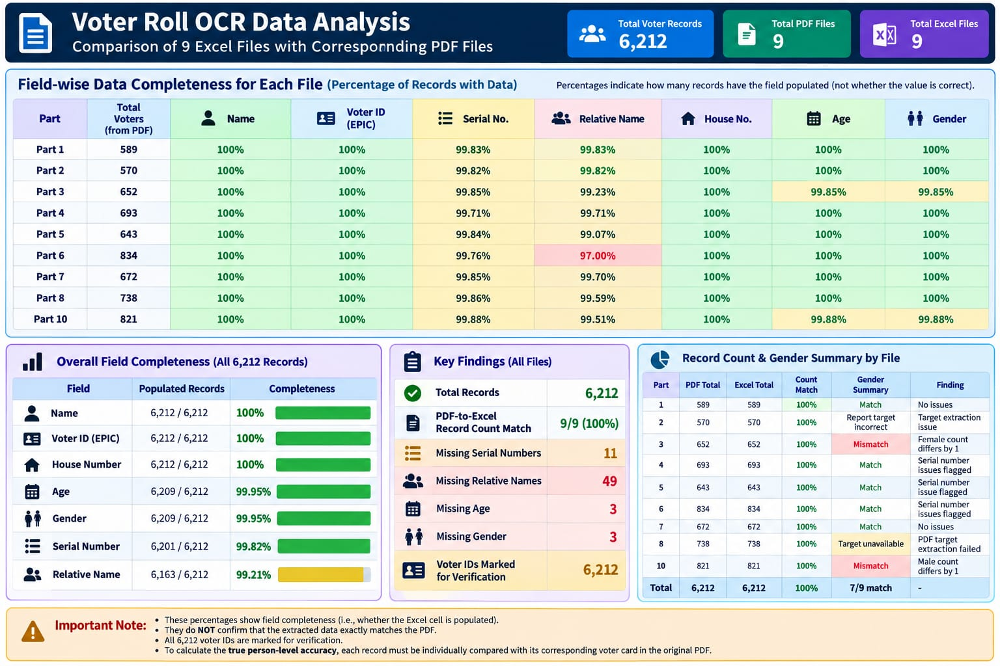
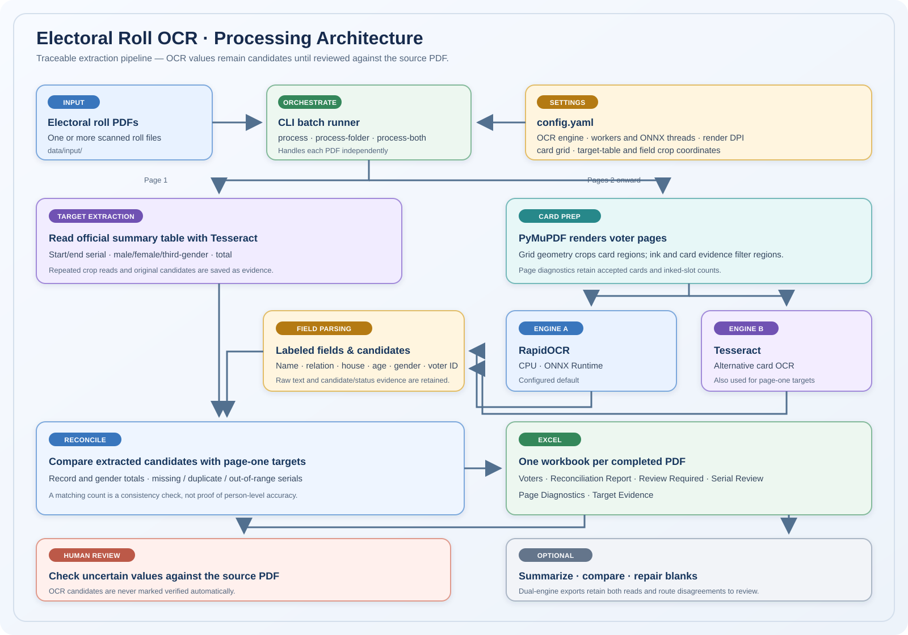

# Electoral Roll OCR

A Python workflow for extracting voter-card fields from scanned electoral-roll PDFs, comparing OCR engines, and reviewing uncertain values in Excel workbooks. The pipeline keeps raw OCR text and candidate evidence so extracted values can be checked against the source PDF.

> **Important:** OCR output is not verified voter data. A populated cell or matching record count does not prove that an individual value is correct. Always review candidate values against the original PDF before relying on them.

## Dashboard example

The image below summarizes the nine-PDF RapidOCR run (parts 1–8 and 10; 6,212 extracted records). It reports field completeness and count reconciliation, not person-level accuracy.



The dashboard shows field completeness and count reconciliation. It does not confirm that extracted values match each voter card.

## Architecture diagram



The CLI is the entry point for single-PDF, folder, dual-engine, summary, comparison, and repair tasks. It loads `config.yaml` and handles each input PDF independently. The page-one and voter-card paths are separate because the first page contains the official count table while the later pages contain the voter cards.

**Page-one target path:** Tesseract reads the starting and ending serials and the elector counts from cropped cells in the summary table. The repeated OCR reads and the selected target values are saved in `Target Evidence`. Those counts become reference values for reconciliation; they are not used to fill voter-card fields.

**Voter-card path:** PyMuPDF renders the voter pages. The configured grid crops each card region, and ink/card-evidence checks screen out non-card regions. The selected card engine (RapidOCR with ONNX Runtime or Tesseract) supplies raw text to the field parser. The parser extracts labeled fields and records voter-ID/serial candidates and statuses. Raw text is kept so uncertain values can be inspected later.

**Reconciliation and review:** The pipeline combines the extracted rows with page-one targets and checks total/gender counts, missing or duplicate serials, out-of-range serials, and missing fields. It writes one workbook after each PDF is completed. `summarize-folder` reports coverage and processing diagnostics; `compare-workbooks` and `process-both` expose engine differences; `repair-folder` applies explicit patterns to saved raw text to fill supported blanks. These tools help prioritize review but do not verify identities. A human must compare uncertain values with the corresponding card in the original PDF.

## How the workflow works

1. **Collect input PDFs.** Place the electoral-roll PDFs in `data/input/`. Each PDF is processed independently; its official summary targets are read from its own first page.
2. **Read page-one targets.** The pipeline uses Tesseract to read the elector summary table, including serial range and male, female, third-gender, and total counts. It repeats OCR on cropped table cells and retains the reads as evidence. When the total conflicts with a complete gender-count sum, the workbook records the original OCR value and the consistency correction. If a value cannot be read confidently, it remains unavailable for reconciliation.
3. **Render voter pages.** Pages from `processing.first_voter_page` through the last page are rendered at the configured card resolution. The configured grid divides each voter page into card regions; inked regions are examined for voter-card evidence so maps and summary tables are not emitted as voter rows.
4. **Run card OCR.** RapidOCR or Tesseract reads each candidate card. The parser looks for labeled fields such as name, relation, house number, age, and gender, and searches for voter-ID candidates. The original card OCR text is retained in the workbook. The engine choice applies to voter cards; page-one target extraction uses Tesseract.
5. **Keep uncertainty visible.** Serial numbers, voter IDs, and other OCR values are candidates, not verified identities. Ambiguous or missing values are left blank or listed with alternatives and review statuses. The pipeline does not infer a serial number from a card's grid position.
6. **Save source cards and export.** Each accepted voter-card crop is saved as a PNG in a sibling `<workbook-name>_images` folder. The `Voters` and `Review Required` sheets include a clickable **source_image** link for each record. Keep that image folder alongside the workbook when moving or sharing it; the Excel links are relative so the workbook and images can move together. After a PDF finishes, the project writes one workbook with voter rows, target evidence, per-page diagnostics, count checks, and review lists. A workbook is saved only after its PDF completes.
7. **Summarize or compare.** The summary command reports target-versus-extracted counts, field population, page errors, and processing time. Engine comparison workbooks show matching and differing readings; compare disagreements with the PDF to determine which engine read is correct.

## Requirements and setup

- Windows
- Python 3.12
- Tesseract OCR installed locally. Page-one target extraction uses Tesseract even when RapidOCR is selected for voter cards. Set `ocr.tesseract_cmd` in `config.yaml` to your `tesseract.exe` location.
- Python dependencies from `requirements.txt`; RapidOCR and ONNX Runtime are installed through this file.

From PowerShell in the project folder:

```powershell
py -3.12 -m venv .venv312
.\.venv312\Scripts\Activate.ps1
python -m pip install --upgrade pip
pip install -r requirements.txt
```

Confirm or update the Tesseract path in `config.yaml`. To check the included unit tests:

```powershell
python -m unittest discover -s tests -v
```

## Input and output folders

```text
data/
  input/                 # Source PDFs; keep local and do not commit voter data
  rapidocr_run/           # Example RapidOCR outputs
  tesseract_output/       # Example Tesseract outputs
  both_engines/           # Engine-specific and combined results
```

The input/output folders are examples; select any paths with the CLI options. Generated spreadsheets, PDFs, and voter data are excluded from Git by `.gitignore`.

## Run one OCR engine on all PDFs

RapidOCR is the configured default. The current configuration uses two page workers and limits ONNX Runtime threads to manage memory:

```powershell
python -m app.cli process-folder --input-dir data/input --output-dir data/rapidocr_run --ocr-engine rapidocr --rapidocr-workers 2
python -m app.cli summarize-folder --output-dir data/rapidocr_run
```

For a folder with many PDFs, work can instead be distributed across PDF workers. Each active PDF then uses one page worker, which keeps the number of live RapidOCR/ONNX engines bounded by the PDF-worker count. Start with two on a machine with enough memory and monitor RAM; more workers are not always faster.

```powershell
python -m app.cli process-folder --input-dir data/input --output-dir data/rapidocr_parallel --ocr-engine rapidocr --pdf-workers 2
python -m app.cli summarize-folder --output-dir data/rapidocr_parallel
```

`--pdf-workers` and `--rapidocr-workers` are mutually exclusive. Use `--rapidocr-workers 2` to process two pages from one PDF at a time, or `--pdf-workers 2` to process two PDFs at a time. The default is one PDF at a time, with page-level concurrency controlled by `processing.rapidocr_workers`.

For Tesseract card OCR, use a separate output directory:

```powershell
python -m app.cli process-folder --input-dir data/input --output-dir data/tesseract_output --ocr-engine tesseract
python -m app.cli summarize-folder --output-dir data/tesseract_output
```

The batch command submits PDFs in filename order. With multiple PDF workers, workbooks finish in whichever order processing completes. It prints page-level progress and a `Finished ...` message after each PDF is written. Run `summarize-folder` after files finish; if the batch is interrupted, only workbooks for already-completed PDFs are available.

To process one PDF or a page range:

```powershell
python -m app.cli process --pdf data/input/roll.pdf --output data/output/roll_ocr.xlsx --ocr-engine rapidocr
python -m app.cli process --pdf data/input/roll.pdf --output data/output/sample_pages.xlsx --start-page 2 --end-page 5 --ocr-engine rapidocr
```

## Run both engines and create comparison workbooks

To process every input PDF with both engines, then export an unfiltered side-by-side workbook and a separate review-oriented candidate workbook for each PDF:

```powershell
python -m app.cli process-both --input-dir data/input --output-dir data/both_engines --rapidocr-workers 2
```

To process separate PDFs concurrently instead, use `--pdf-workers 2`; each active PDF uses one page worker while Tesseract and RapidOCR are run for that PDF.

The output contains `tesseract/` and `rapidocr/` engine folders, `both_engines_unfiltered/`, and `final_candidates/`. The unfiltered workbook retains both engines' readings and raw OCR text. The candidate workbook includes the available engine readings, consensus-only values, and a review queue. Engine agreement is not proof of correctness.

If both engine workbooks already exist, create the combined workbooks without running OCR again:

```powershell
python -m app.cli combine-engines --tesseract-dir data/tesseract_output --rapidocr-dir data/rapidocr_run --output-dir data/combined_engines
```

For one pair of workbooks, create a field-level comparison:

```powershell
python -m app.cli compare-workbooks --baseline data/tesseract_output/NAME_ocr.xlsx --candidate data/rapidocr_run/NAME_ocr.xlsx --output data/engine_comparison.xlsx
```

This reports populated fields, agreement, and disagreement. It is an OCR-to-OCR comparison, not an accuracy score; manually inspect differences against the PDF.

## Reuse saved raw OCR text to fill blanks

`repair-folder` applies explicit field-label patterns to existing `raw_text` cells. It is a deterministic local parser, not a connected LLM. It fills missing values only when the saved text supports the field, keeps voter IDs and serials as unverified candidates, and writes a separate set of workbooks.

```powershell
python -m app.cli repair-folder --input-dir data/rapidocr_run --output-dir data/pattern_output
python -m app.cli summarize-folder --output-dir data/pattern_output
```

## Excel workbook contents

Each completed PDF workbook contains:

- **Voters** — one row per accepted voter-card region, including page/grid location, extracted fields, raw OCR text, candidates, and statuses.
- **Reconciliation Report** — official page-one targets compared with extracted record and gender counts, plus missing/duplicate/out-of-range checks.
- **Serial Review** — duplicate, missing, ambiguous, and out-of-range serials.
- **Review Required** — rows with missing values or candidate statuses that still need verification.
- **Page Diagnostics** — accepted cards, inked grid slots, failed fields, processing errors, and duration for each voter page.
- **Target Evidence** — page-one OCR text, cell-level candidate reads, selected targets, and any consistency correction.

The summary command prints the same key metrics in the terminal:

```powershell
python -m app.cli summarize-folder --output-dir data/rapidocr_run
```

## Interactive record review dashboard

Open the OCR workbooks in a local browser dashboard. It shows the selected voter's card image inline beside extracted fields, serial and voter-ID status/candidates, grid location, and expandable raw OCR evidence. Search across records, filter to records needing review or with missing fields, and move between cards. The dashboard reads the workbook's relative source-image hyperlink and serves only the matching PNG from its sibling `<workbook-name>_images` directory.

```powershell
python -m app.cli dashboard --workbook-dir data/rapidocr_run
```

Then open `http://127.0.0.1:8765` in your browser. Press `Ctrl+C` in the terminal to stop it. The dashboard binds to loopback by default and does not upload data. It needs workbooks generated by the current OCR version, including their `_images` folders; rerun OCR for older outputs that do not contain source-card images. For a different output location, pass that folder to `--workbook-dir` (for example `data/output`).

Field coverage means a cell is populated; it does not measure whether the cell matches the printed voter card. To calculate person-level accuracy, compare labeled fields in a representative sample (or all records) directly against the source PDF and record the correct values as ground truth.

## Configuration and tuning

Edit `config.yaml` to change:

- `ocr.engine`: default voter-card engine (`rapidocr` or `tesseract`).
- `ocr.tesseract_cmd`: local Tesseract executable path.
- `ocr.page1_dpi` and `ocr.card_dpi`: page render resolutions.
- `processing.max_workers` and `processing.max_workers_limit`: Tesseract page concurrency and its upper bound.
- `processing.rapidocr_workers`: RapidOCR page concurrency when processing one PDF at a time.
- `processing.pdf_workers`: number of PDFs processed concurrently. Each active PDF uses one page worker to bound total engine instances.
- `processing.rapidocr_intra_op_threads` and `processing.rapidocr_inter_op_threads`: ONNX Runtime threading.
- `grid`: card grid columns, rows, margins, and inner padding. The supplied PDF family uses a three-column, ten-row grid; different layouts need recalibration.
- `validation`: voter-ID/gender/serial crops and page-one target-table crop coordinates.
- `diagnostics.debug_dir`: location for saved card crops when crop-level inspection is needed.

`--start-page` and `--end-page` are one-based PDF page numbers. The default starts voter extraction at page 2 because page 1 contains the official count table.

## Current dashboard and evaluation caveats

The dashboard included above reflects the nine source PDFs available during the October 2026 run. Parts 1, 2, 3, 4, 5, 6, 7, 8, and 10 produced 6,212 rows. Page-one targets were unavailable for part 8; the extracted total for part 2 conflicted with its page-one OCR target; and gender counts differed by one for parts 3 and 10. Eleven serial values were missing across the files. Review the workbook evidence before using any extracted values.

All voter ID values shown as populated in the dashboard are OCR candidates and remain unverified. Do not treat the dashboard's 100% voter-ID completeness as 100% voter-ID accuracy.
